<div align="center">


# FieldShift

**Compare crop rotation options with NASA Earth data, before changing anything in the field.**

[](https://www.spaceappschallenge.org/2026/challenges/adapting-farms-with-nasa-data/)
[](https://www.python.org/)
[](https://fastapi.tiangolo.com/)
[](https://react.dev/)
[](https://www.typescriptlang.org/)
[](https://threejs.org/)
[](https://vite.dev/)
[](https://leafletjs.com/)

[Tour](#a-quick-tour) · [How it works](#how-it-works) · [Data](#data-sources) · [Getting started](#getting-started) · [API](#api) · [Status](#project-status)

<br>

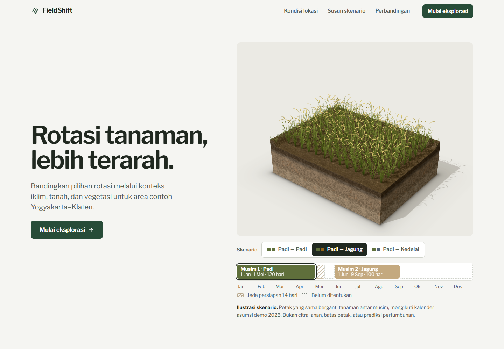

</div>

<br>

FieldShift helps farmers and extension workers think through a change in crop rotation. It puts the rotation a farmer uses now next to two alternatives over the same planning period, and shows the climate, soil and vegetation evidence, the crop constraints, and the information still missing for each one.

Built for the NASA Space Apps Challenge 2026 challenge [**Field Shift: Adapting Farms with NASA Data**](https://www.spaceappschallenge.org/2026/challenges/adapting-farms-with-nasa-data/).

> **The question it answers:** *"What should I consider if I change the crop rotation at this location?"*

<table>
  <tr>
    <td align="center" width="33%">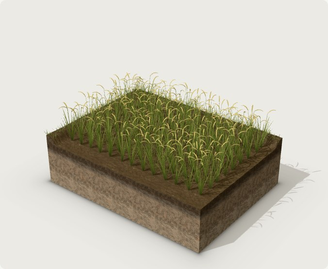</td>
    <td align="center" width="33%">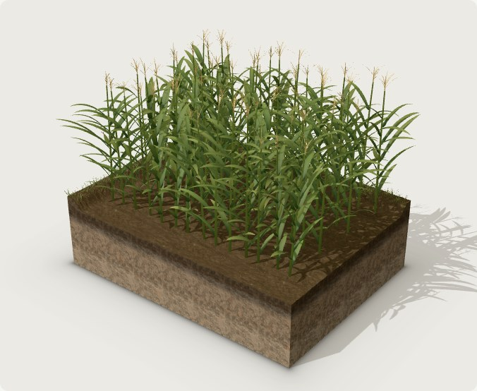</td>
    <td align="center" width="33%">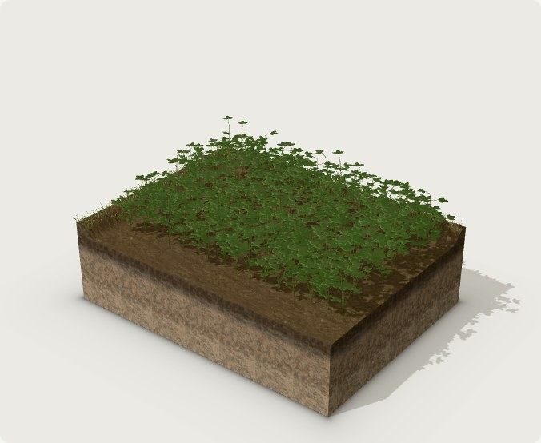</td>
  </tr>
  <tr>
    <td align="center"><b>Rice</b> · season 1</td>
    <td align="center"><b>Maize</b> · season 2</td>
    <td align="center"><b>Soybean</b> · season 2</td>
  </tr>
</table>

<p align="center"><sub>The same plot across seasons, rendered in three.js with a 1 m soil profile. It illustrates the demo calendar; it is not imagery of a real field.</sub></p>

## At a glance

| | |
|---|---|
| **Demo area** | Yogyakarta–Klaten, Indonesia (two sample points in rural Klaten) |
| **Crops** | Rice, maize, soybean |
| **Comparison** | One location, one planning horizon, three strategies: current rotation and two alternatives |
| **Checks** | 12 agronomic and calendar checks per strategy (method v0.1.0) |
| **NASA data** | POWER daily climate (1991–2026) and MODIS Terra/Aqua vegetation indices (2021–2026) |
| **Interface** | Indonesian, responsive for phone and laptop |
| **Accounts** | None. Inputs live only in the browser session; the API stores nothing. |

## A quick tour

The screenshots below come from the running app. The interface is in Indonesian.

### 1. Read the location

Pick one of the two Klaten sample points or drop your own pin. Every layer shows its source, period and spatial support, and says plainly when it has no data for that point.

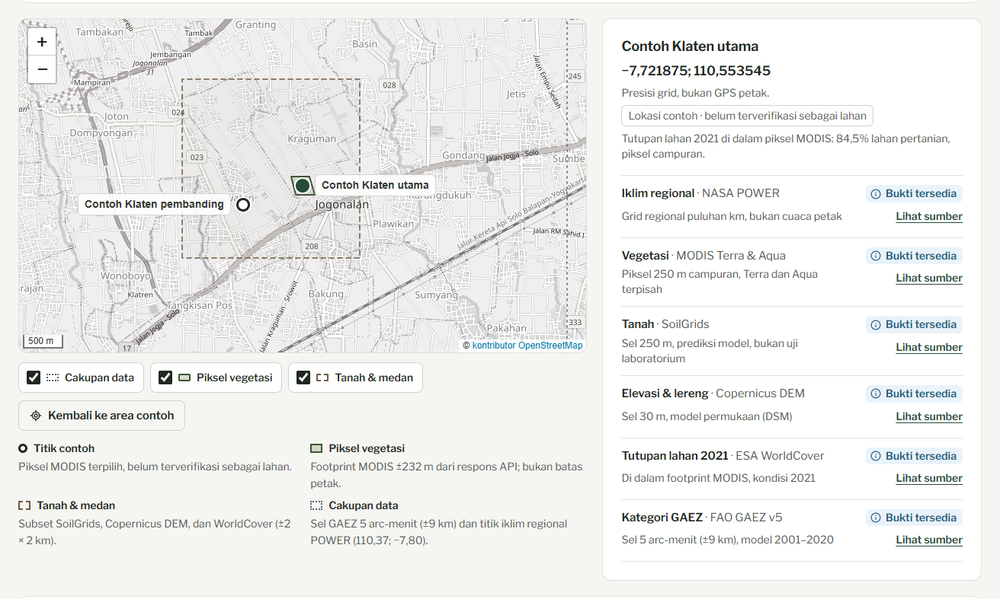

<table>
  <tr>
    <td width="50%">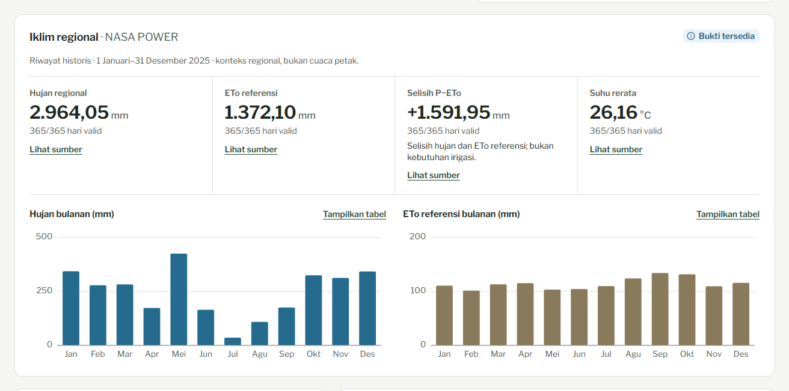</td>
    <td width="50%">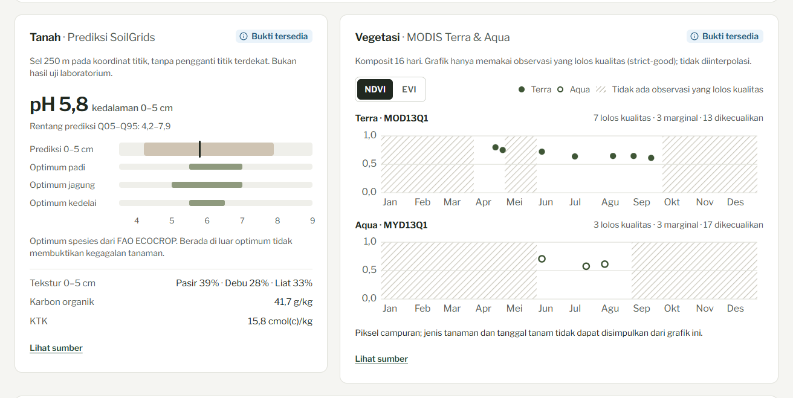</td>
  </tr>
  <tr>
    <td><b>Climate</b> from NASA POWER: rainfall, reference ETo, P−ETo and temperature, with valid-day counts for every total.</td>
    <td><b>Soil and vegetation</b>: SoilGrids pH against each crop's optimum range, and MODIS NDVI/EVI using only QA-passing points. Gaps stay visible.</td>
  </tr>
</table>

### 2. Build a scenario

A three-step form covers location and period, rotation and calendar, then water conditions and priorities. Blank fields are recorded as "don't know", never as zero, and the checks that need them wait for that information.

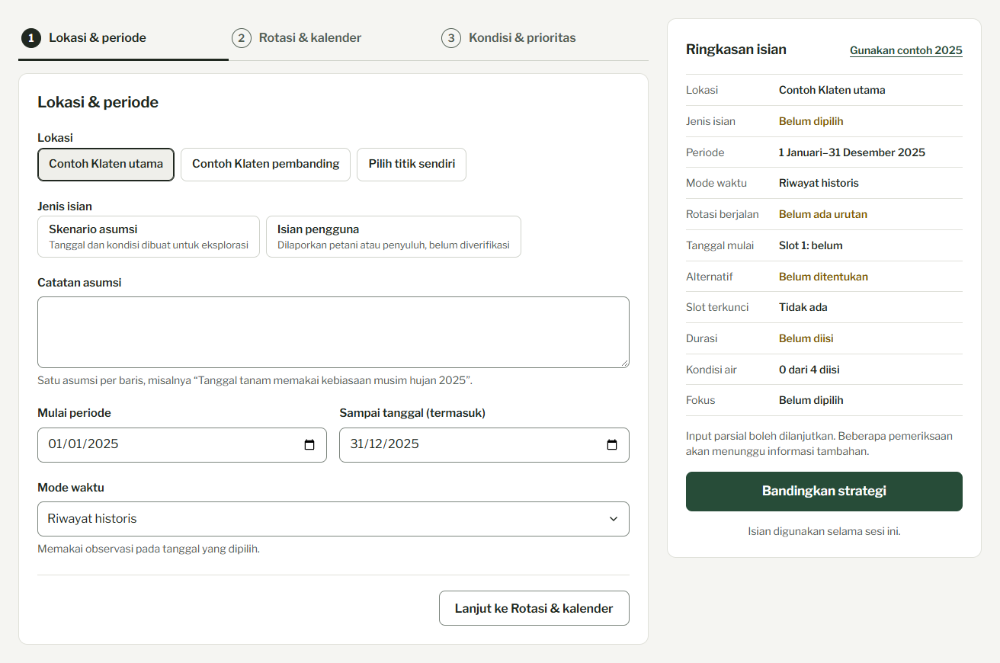

### 3. Compare three strategies

The current rotation and two alternatives sit side by side on the same calendar, with their status and the information each one still needs.

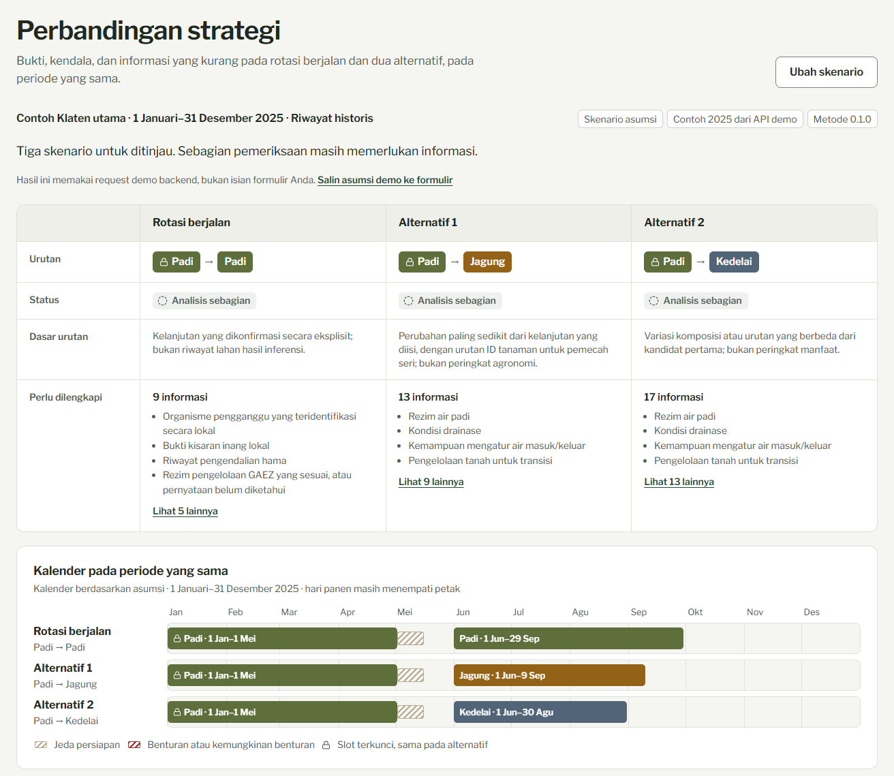

<details>
<summary><b>See all 12 checks</b></summary>
<br>
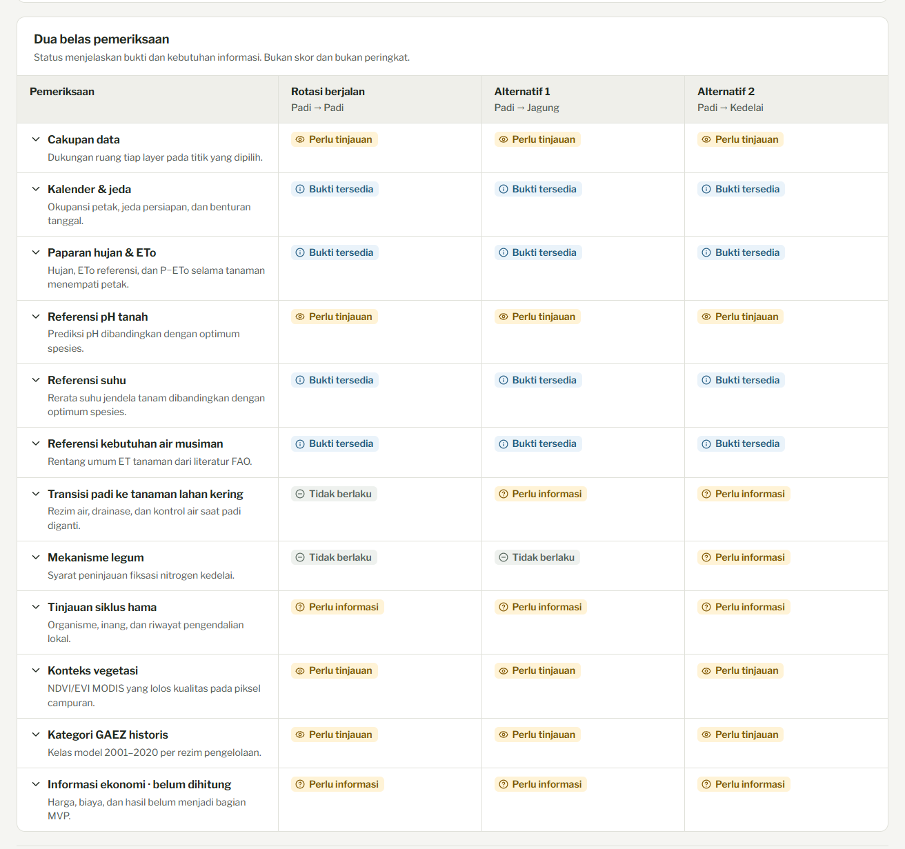
</details>

### 4. On a phone

<p align="center">
  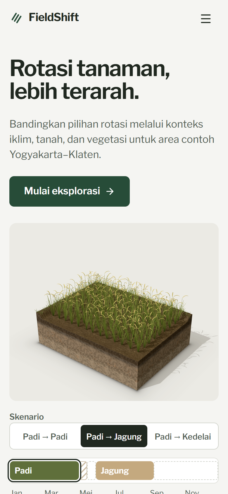
  &nbsp;&nbsp;&nbsp;
  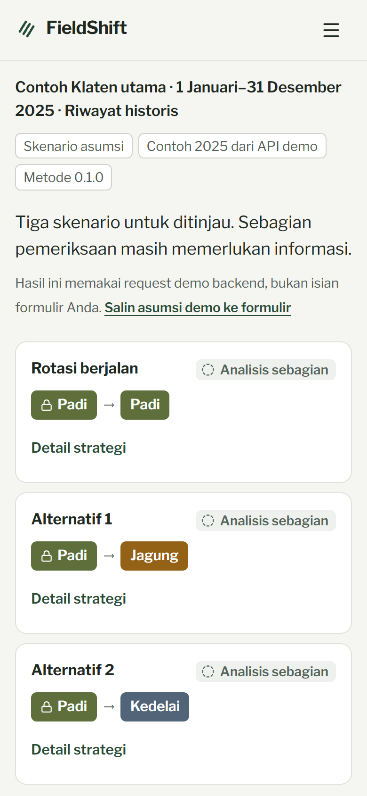
</p>

## How it works

```mermaid
flowchart LR
  subgraph SRC["Public data sources"]
    direction TB
    POWER["NASA POWER<br/>daily climate"]
    MODIS["NASA MODIS<br/>NDVI / EVI + QA"]
    SG["ISRIC SoilGrids"]
    DEM["Copernicus DEM"]
    WC["ESA WorldCover"]
    FAO["FAO GAEZ v5 · FAO-56"]
  end

  subgraph PKG["Prepared data package"]
    direction TB
    PREP["data/prepared<br/>390 files"]
    SUPP["data/supplemental<br/>526 files"]
    MAN["SHA-256 manifests"]
  end

  subgraph API["FastAPI backend"]
    direction TB
    CTX["Context layers"]
    GEN["Strategy generator<br/>and calendar"]
    CHK["12 checks"]
  end

  subgraph WEB["React frontend"]
    direction TB
    MAP["Map and charts"]
    FORM["Scenario form"]
    CMP["Three-strategy comparison"]
    DIO["3D diorama"]
  end

  SRC -- "scripts/data" --> PKG
  PKG -- "hash-verified at startup" --> API
  API -- "/api/v1" --> WEB
```

1. **Data preparation.** Scripts in `scripts/data/` pull small subsets from each public source, run QA, and write them with a SHA-256 manifest.
2. **Backend.** On startup, FastAPI checks every file against its manifest and refuses to serve (`503`) if anything is missing or changed. It then extracts context for a point, generates candidate rotations, builds calendars, and runs the 12 checks.
3. **Frontend.** React renders the map, charts, form and comparison from the API, with a three.js diorama of the scenario in the hero.

### Guardrails

FieldShift reports evidence and gaps. It does not pretend to know more than the data supports.

- **No ranking, scores, yield prediction, water-saving percentages, nitrogen credits or profit.** The method is not calibrated for those claims, so the API returns them as `null`.
- **No local agronomic validation yet.** Every result carries `local_agronomic_validation: false`.
- **No silent nearest-neighbour fallback.** If a layer has no value for a location, the app says so instead of borrowing a nearby value.
- **Historical climate is never labelled a forecast, and P−ETo is never labelled irrigation demand.**
- **Point-based analysis.** Field polygons are not supported yet.

## Data sources

| Layer | Source | Coverage in this repo |
|---|---|---|
| Climate (daily, monthly, 1991–2020 baseline) | [NASA POWER](https://power.larc.nasa.gov/) | One regional point, 1991–2025 plus partial 2026 |
| Vegetation (NDVI/EVI with QA) | [NASA MODIS via ORNL DAAC](https://modis.ornl.gov/data/modis_webservice.html), Terra and Aqua kept separate | Two Klaten pixels, 2021–2026 |
| Soil (12 properties × 5 depths × mean/Q05/Q95) | [ISRIC SoilGrids](https://docs.isric.org/globaldata/soilgrids/) (CC BY 4.0) | About 2 × 2 km subset |
| Elevation and slope | [Copernicus DEM GLO-30](https://registry.opendata.aws/copernicus-dem/) | Same subset |
| Land cover | [ESA WorldCover 2021](https://esa-worldcover.org/) (CC BY 4.0) | Same subset and MODIS footprints |
| Crop suitability categories | [FAO GAEZ v5](https://gaez.fao.org/) | Two points × three crops × two water regimes |
| Crop water references | [FAO-56](https://www.fao.org/4/x0490e/x0490e00.htm) | Reference tables only |
| Indonesian varieties | Kementan / BRMP catalogues | Reference durations, not farmer defaults |
| Short-range weather snapshot | BMKG | Reference only, expires quickly |

Each layer keeps its own attribution, access time and checksums in the `manifest.json` next to it. See [data/prepared/README.md](data/prepared/README.md) and [data/supplemental/readiness-audit.json](data/supplemental/readiness-audit.json) for coverage, gaps and QA details.

## Getting started

**Requirements:** Python 3.11, Node.js with npm.

### 1. Backend

From the repository root (PowerShell):

```powershell
py -3.11 -m venv .venv
.venv\Scripts\python.exe -m pip install -r backend/requirements-lock.txt
.venv\Scripts\python.exe -m uvicorn backend.fieldshift.app:app --host 127.0.0.1 --port 8000
```

On macOS or Linux, use `python3.11 -m venv .venv` and `.venv/bin/python` instead.

Interactive API docs are at http://127.0.0.1:8000/docs.

### 2. Frontend (development)

With the backend running:

```powershell
cd frontend
npm install
npm run dev
```

Open http://localhost:5173. The dev server proxies `/api` and `/health` to the backend.

### 3. Single server

Run `npm run build` in `frontend/`, then restart the backend. FastAPI serves the built app at http://127.0.0.1:8000/ alongside the API.

## API

| Endpoint | Purpose |
|---|---|
| `GET /health` | Readiness and data integrity status |
| `GET /api/v1/catalog` | Coverage, manifests, time modes, sources |
| `GET /api/v1/locations` | The two Klaten sample points |
| `GET /api/v1/crops` | Rice, maize, soybean references |
| `GET /api/v1/input-contract` | JSON Schema for partial farm input documents |
| `POST /api/v1/context` | Climate, soil, terrain, vegetation, GAEZ and land cover for a point and time window |
| `POST /api/v1/climate/monthly` | Monthly climate slices for charts |
| `POST /api/v1/compare` | Three strategies with 12 checks, status, missing inputs and sources |
| `GET /api/v1/demo` | A labelled 2025 historical demo request and its recomputed result |

<details>
<summary><b>Example request</b></summary>

```json
POST /api/v1/context
{
  "location": { "example_id": "klaten_cropland_primary" },
  "window": { "start_date": "2025-01-01", "end_exclusive": "2026-01-01" },
  "time_mode": "historical_replay"
}
```

End dates are always exclusive. Time modes are `historical_replay`, `recent_partial` and `historical_analogue_not_forecast`.

</details>

Full request rules and error formats are in [backend/README.md](backend/README.md). The OpenAPI contract is in [outputs/backend-openapi.json](outputs/backend-openapi.json).

## Verification

```powershell
# Method and backend tests, real HTTP checks, manifest checks
.venv\Scripts\python.exe scripts/verify_backend.py

# Rotation method reference checks
.venv\Scripts\python.exe scripts/method/verify_rotation_method.py

# Offline data package checks
.venv\Scripts\python.exe scripts/data/validate_prepared_data.py
.venv\Scripts\python.exe scripts/data/audit_data_completeness.py
```

The latest recorded run ([outputs/backend-verification.json](outputs/backend-verification.json)) passed 55 method tests, 79 backend tests and 5 real HTTP checks, with all 916 data file hashes verified.

## Repository layout

<details>
<summary><b>Show folders</b></summary>

| Path | Contents |
|---|---|
| `backend/fieldshift/` | FastAPI app: data repository, context layers, rotation analysis, input validation |
| `frontend/` | Single-page landing site and exploration tool |
| `data/prepared/` | Initial public data package (390 files with SHA-256 manifest) |
| `data/supplemental/` | Additional public data and the 119-field typed input contract (526 files with manifest) |
| `scripts/data/` | Data download, preparation, QA and packaging scripts |
| `scripts/method/` | Reference implementation of the rotation method |
| `specs/` | Rotation method spec (`rotation-method-v1.json`) and demo fixture |
| `tests/` | Method and backend tests |
| `docs/` | MVP spec, roadmap, rotation method, design briefs (Indonesian), README images |
| `outputs/` | Audit reports, demo request/response, OpenAPI contract, verification reports, data package ZIPs |
| `work/` | Early research samples and challenge page snapshot |

</details>

## Project status

| Stage | Status |
|---|---|
| 0. Public data foundation | ✅ Done |
| 1. MVP definition | ✅ Done ([docs/mvp.md](docs/mvp.md)) |
| 2. Rotation analysis method | ✅ Done ([docs/rotation-method.md](docs/rotation-method.md)) |
| 3. Backend | ✅ Done |
| 4. Interface | ✅ Done |
| 5. Testing and local agronomic validation | ✅ Done |
| 6. Challenge demo | ✅ Done |

See [docs/roadmap.md](docs/roadmap.md) for details. The app is not deployed yet.

## Notes for contributors

- **Do not edit files under `data/` by hand.** The backend refuses to start if a hash no longer matches its manifest. `.gitattributes` marks `data/` as binary so git does not change line endings on checkout.
- **Vendored libraries are not in the repo.** Some data scripts look for local copies of numpy/rasterio and jsonschema. Recreate them if you need to rerun those scripts:

  ```powershell
  python -m pip install --target scripts/data/soil-terrain/_vendor -r scripts/data/soil-terrain/requirements.txt
  python -m pip install --target work/validation-deps jsonschema==4.26.0
  ```

  The backend itself only needs `backend/requirements-lock.txt`.
- **Unknown values stay `null`.** A known zero, an explicit "none" and "don't know" mean different things throughout the input contract.

## Acknowledgements

- **NASA** POWER and MODIS (distributed by ORNL DAAC) for climate and vegetation data.
- **ISRIC SoilGrids**, **Copernicus DEM** (European Union / ESA / Airbus / DLR), **ESA WorldCover** 2021, **FAO** GAEZ v5 and FAO-56, **Kementan/BRMP** and **BMKG** for soil, terrain, land cover, crop and weather references.
- Map tiles © [OpenStreetMap](https://www.openstreetmap.org/copyright) contributors. Soil textures from [Poly Haven](https://polyhaven.com/) (CC0). Typeface [Libre Franklin](https://fonts.google.com/specimen/Libre+Franklin).

<p align="center"><sub>Built for NASA Space Apps Challenge 2026 · Field Shift: Adapting Farms with NASA Data</sub></p>
